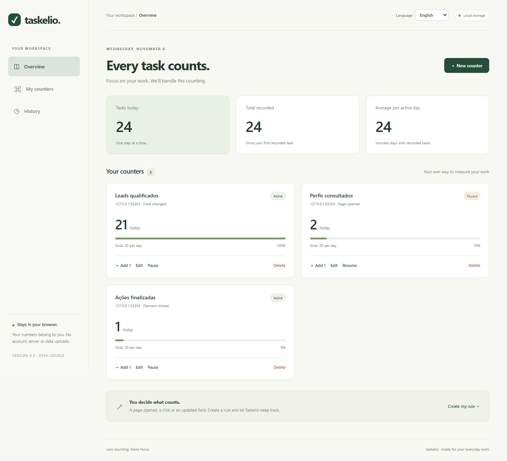

<p align="center"></p>

# Taskelio · Your work, counted

[Português](README.md) · **English**

[](https://github.com/blajeen/taskelio/actions/workflows/checks.yml)
[](LICENSE)

**An open source Chrome and Edge extension that counts work activities using rules you define.**

Decide what counts as a completed task: a field changing to `Yes`, a button being clicked or a profile page being opened. Track your progress without counting manually.

**[Download the extension](https://github.com/blajeen/taskelio/releases/latest) · [User guide](docs/USAGE.en.md) · [Contributing](CONTRIBUTING.md)**

No account, server, telemetry or runtime dependencies. Taskelio is an installable browser extension; you do not need to host a website or run a server.



*The screenshot uses fictional test data. A new installation starts with no counters. User-created counter names are preserved when switching languages.*

## Features

- Website and page path rules, with `*` wildcards.
- Page visits, including SPA navigation, clicks and field changes to a target value.
- Visual element selection, element testing and manual CSS selectors.
- Count once per item/day, once per item ever, or every occurrence with a 1.2-second duplicate guard.
- Daily goals, totals, average per active day, history, manual corrections and CSV export.
- Optional access per website, with data stored in your browser.
- English and Portuguese interfaces. Select **Language** in the dashboard or popup; your choice is saved locally.

## Install the extension

1. Open [Releases](https://github.com/blajeen/taskelio/releases/latest) and download **`taskelio-v0.2.0.zip`** under **Assets**.
2. Extract the ZIP into a permanent folder on your computer.
3. Open `chrome://extensions` in Chrome or `edge://extensions` in Edge.
4. Enable **Developer mode**.
5. Click **Load unpacked** and select the extracted folder containing `manifest.json`.
6. Pin Taskelio in the browser’s extensions menu, open its icon and click **Open my dashboard**.

If you download the full source using **Code → Download ZIP**, extract it and select the project’s **`extension`** subfolder in step 5.

You do not need Node.js, commands or a build step to use the extension. This initial release is distributed through GitHub, is not listed in the Chrome/Edge stores and does not update automatically. To update, extract the new version into the same folder and click **Reload** on the browser’s extensions page. Avoid uninstalling, which removes local data. Firefox is not supported yet.

## Create your first counter

1. Open your work website in another tab and sign in normally.
2. Open Taskelio and click **New counter**.
3. Enter the website, page path and trigger type.
4. Allow access to that website when your browser asks.
5. For fields or clicks, choose **Select on page**, click the element and return to the dashboard.
6. Check it with **Test element**, choose a repeat policy and click **Save counter**.

For example, to count qualified leads:

- **Website:** your actual CRM domain, such as `https://your-company.pipedrive.com`. This is a configuration example, not a validated Pipedrive connector.
- **Page path:** the real path used for profiles, such as `/person/*`, including `#` routes if needed.
- **When should it count?** A field changes to a value.
- **Watched element:** visually select the field’s value or enter a stable CSS selector.
- **Expected value:** `Yes`, for example. Checkboxes use `true` and `false`.
- **Repeat policy:** once per item, ever, if each profile should count only once.

**Test element** checks the selector without recording a task. A field’s first observed value is a baseline: opening an already-completed item does not count as new work. The extension needs to observe the transition. Matching ignores case and repeated whitespace.

For visited profiles, use the page-open trigger and a path restricted to profile pages. By default, an item is origin + path + fragment (`#`), excluding query parameters. If IDs only appear in a query parameter or multiple records share a page, configure **Element containing the item ID**. Taskelio reads `data-id`, `href`, or the element’s value/text. Missing identifiers prevent counting. The current version watches one element per rule; multi-row tables need additional capabilities or future connectors.

See the [full user guide](docs/USAGE.en.md) for examples and troubleshooting.

## Languages

The first launch uses Portuguese for Portuguese browser locales and English otherwise. You can override this with the **Language** selector in either the dashboard or popup. The preference is shared between extension pages and saved in this browser profile. Dates, number formatting, interface labels and CSV headers follow the chosen language. Browser permission prompts and built-in form validation follow the browser’s own language.

Counter names, website content, expected field values, rules and recorded events are not translated or rewritten. Changing languages does not reset your counters. For example, a rule matching `Yes` continues to match `Yes` when you select Portuguese.

## Privacy and limitations

The observer reads configured elements and sends the item identifier to the extension’s local background process, which hashes it with SHA-256 before storage. History stores the hash, counter name, date and count source, not each event’s URL or field contents. Hashing does not anonymize low-entropy data. Rule names, selectors, website domains and expected values are also part of your locally stored configuration. CSV exports exclude item identifiers.

Taskelio makes no network requests. Uninstalling the extension or deleting your browser profile can remove its data. Browser storage has limits; failed writes are not reported as successful counts. Export your history periodically. CSV is a report, not an importable backup of your rules.

Clicks measure intent, not confirmed success. Prefer field changes for completed work. Taskelio does not work on internal browser pages, in iframes, closed Shadow DOM or desktop Excel. Fast changes between observations can be missed; absent fields only get a baseline when they appear. This is not an audit-grade system or a replacement for official CRM reports. Use **Undo** for corrections; changing a field back does not automatically subtract a count.

Each record uses the browser’s local timezone at the time it is created. The average includes days with valid records, not configured working days. Deleting a rule keeps its history. Revoking a website’s permission removes future script registrations; scripts already loaded in a tab may remain until the tab reloads, subject to background permission checks.

## Development

```sh
npm ci
npm test
npm run check
npx playwright install chromium
npm run test:browser
npm run package
```

Packaging creates `dist/taskelio` and `dist/taskelio-v0.2.0.zip`. Browser tests use a disposable extension copy with access pregranted only to a local test server. The actual browser website-permission dialog still needs manual verification.

UI translations live in `extension/i18n.js`; native extension metadata is in `extension/_locales`. Tests check translation coverage, interpolation fields, language switching, persistence and preservation of existing rules and history.

The counting core is separate from the browser observer, preparing the project for future connectors. See the [architecture](docs/ARCHITECTURE.md) and [contribution guidelines](CONTRIBUTING.md), currently in Portuguese.

## Roadmap

- Importable/exportable rule templates without personal data.
- More community-contributed languages.
- A versioned connector interface and system-specific integrations.
- Multiple rows and spreadsheet contexts.
- A separate Excel integration.
- Weekly goals and configurable working days.

## License

[MIT](LICENSE).
