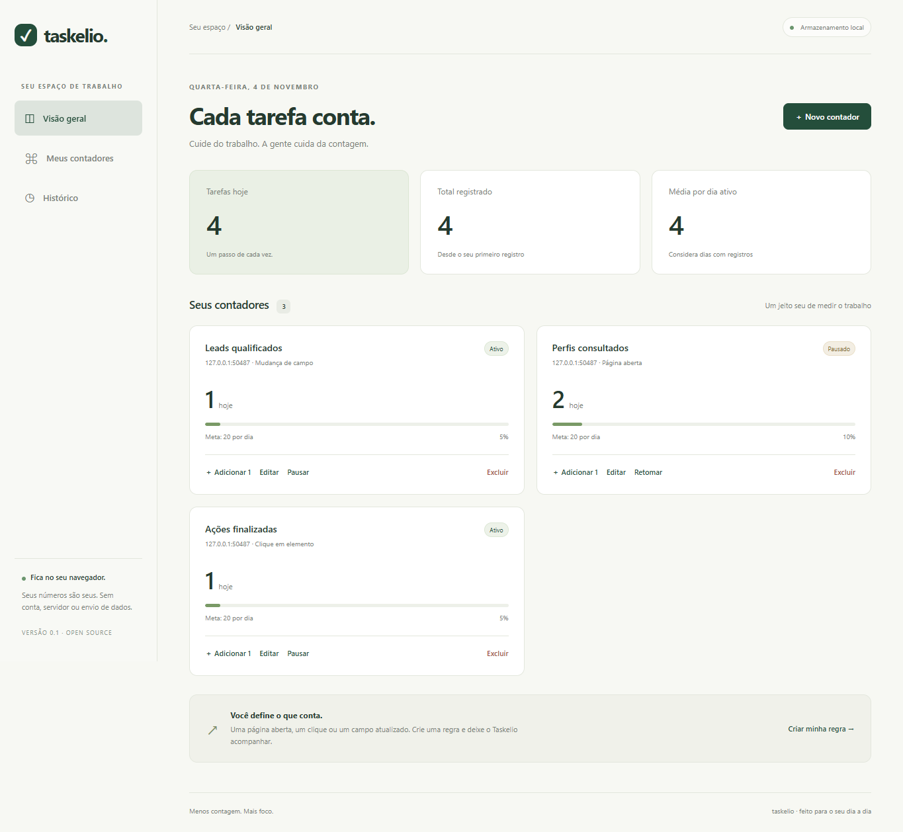

<p align="center"></p>

# Taskelio · Seu trabalho, contado

[](https://github.com/blajeen/taskelio/actions/workflows/checks.yml)
[](LICENSE)

**Uma extensão para Chrome e Edge que conta suas atividades de trabalho com regras criadas por você.**

Configure o que deve contar como tarefa feita: um campo mudar para `Yes`, um botão receber um clique ou uma página de perfil ser aberta. Acompanhe seu dia sem contar manualmente.

**[Baixar a extensão](https://github.com/blajeen/taskelio/releases/latest) · [Como usar](docs/USAGE.md) · [Contribuir](CONTRIBUTING.md)**

Sem conta, servidor, telemetria ou dependências em tempo de execução. O Taskelio é uma extensão instalável; não é necessário hospedar um site nem executar um servidor.



*Painel com dados fictícios de teste. Os contadores começam vazios na instalação.*

## Primeira versão

- Regras por site e caminho, com `*` como curinga.
- Gatilhos: abertura de página (inclusive navegação SPA), clique e mudança de campo para um valor.
- Seletor visual, teste de elemento e edição manual de seletores CSS.
- Repetição por item/dia, uma vez por item ou por ocorrência (com proteção de 1,2 segundo contra duplicação).
- Metas diárias, total, média por dia com registros, histórico, correções e exportação CSV.
- Acesso opcional por site; dados guardados no navegador.

## Instalar a extensão

1. Abra a [página de versões](https://github.com/blajeen/taskelio/releases/latest) e baixe **`taskelio-v0.1.0.zip`**, na seção **Assets**.
2. Extraia o ZIP para uma pasta permanente no seu computador.
3. Abra `chrome://extensions` no Chrome ou `edge://extensions` no Edge.
4. Ative **Modo do desenvolvedor**.
5. Clique em **Carregar sem compactação** (ou **Carregar expandida**) e escolha a pasta extraída que contém `manifest.json`.
6. No menu de extensões do navegador, fixe o Taskelio e abra **Meu painel** pelo botão **Abrir meu painel**.

Se preferir baixar o código pelo botão **Code → Download ZIP**, extraia o projeto e selecione a subpasta **`extension`** no passo 5.

Não precisa instalar Node.js, rodar comandos ou compilar para usar. A versão inicial é distribuída pelo GitHub; ainda não está nas lojas do Chrome/Edge e não tem atualização automática. Para atualizar, extraia a nova versão na mesma pasta e clique em **Recarregar** na página de extensões. Evite desinstalar: isso remove os dados locais. Firefox ainda não é suportado.

## Criar seu primeiro contador

1. Abra o site de trabalho em outra aba e entre normalmente na sua conta.
2. No painel do Taskelio, clique em **Novo contador**.
3. Preencha o site, o caminho e o tipo de gatilho.
4. Autorize o acesso ao site quando o navegador pedir.
5. Para campos e cliques, use **Selecionar na página**, clique no elemento e volte ao painel.
6. Confira o elemento com **Testar elemento**, ajuste a repetição e clique em **Salvar contador**.

Consulte o [guia completo com exemplos e solução de problemas](docs/USAGE.md).

Abra uma página do seu sistema em outra aba e crie um contador no painel:

- **Site:** `https://sua-empresa.pipedrive.com` (exemplo; não existe conector específico).
- **Caminho:** `/person/*` ou o caminho real do sistema, incluindo `#` se necessário.
- **Gatilho:** um campo mudar para um valor.
- **Elemento:** selecione visualmente ou informe um seletor CSS estável.
- **Valor esperado:** `Yes`, por exemplo. Checkboxes usam `true` e `false`.
- **Repetição:** uma vez por item, se cada perfil só deve contar uma vez.

Use **Testar elemento** para verificar se o seletor encontra o campo. O teste não gera contagens. O valor inicial de um campo é uma referência: abrir algo já concluído não conta; é preciso observar a transição. Valores são comparados ignorando maiúsculas e espaços repetidos.

Para perfis visitados, escolha abertura de página e um caminho restrito aos perfis. O item padrão é origem + caminho + fragmento (`#`), sem parâmetros de busca. Se o identificador estiver em um parâmetro de URL ou houver vários registros na mesma página, configure **Elemento com o identificador do item**. A extensão lê `data-id`, `href` ou valor/texto desse elemento. Um identificador ausente impede a contagem. A versão inicial acompanha um elemento por regra; tabelas com várias linhas exigem regras específicas ou um futuro conector.

## Privacidade e limites

O observador lê apenas os elementos configurados e envia o identificador ao processo local da extensão, onde ele é transformado em SHA-256 antes de persistir. O histórico guarda o hash, nome do contador, data e origem da contagem; não guarda a URL de cada evento nem o conteúdo do campo. Hashes não tornam dados de baixa entropia anônimos. Nomes de regras, seletores, domínio e valor esperado também ficam na configuração local. O CSV não inclui identificadores.

Não há chamadas de rede pelo Taskelio. O navegador pode remover dados quando a extensão é desinstalada ou o perfil é apagado. O armazenamento local tem limites do navegador; erros de gravação não são tratados como sucesso. Faça exportações do histórico. O CSV é um relatório, não um backup de regras importável.

Cliques representam intenção, não sucesso confirmado. Use mudança de campo para medir conclusão. A extensão não funciona em páginas internas do navegador, iframes, Shadow DOM fechado ou no Excel desktop. Mudanças muito rápidas entre duas leituras podem não ser capturadas; campos ausentes só recebem uma referência quando aparecem. Não promete precisão de auditoria nem substitui o relatório oficial do sistema. Para reverter uma contagem, use **Desfazer**; mudar o campo de volta não desconta automaticamente.

Dias seguem o fuso local do navegador no momento do registro. A média considera apenas dias com registros válidos, e não dias de trabalho configurados. Excluir uma regra mantém o histórico. Ao desautorizar um site, os scripts deixam de ser registrados para ele; scripts já carregados podem permanecer na aba até recarregá-la, sujeitos às validações do processo de fundo.

## Desenvolvimento

```sh
npm test
npm run check
npm run package
```

O último comando copia a extensão para `dist/taskelio`. Os testes de integração usam Playwright (dependência de desenvolvimento):

```sh
npm install
npx playwright install chromium
npm run test:browser
```

Os testes abrem uma cópia temporária da extensão com acesso pré-autorizado apenas ao servidor local de teste. A caixa de diálogo de autorização de sites do navegador deve ser verificada manualmente.

Veja [a arquitetura](docs/ARCHITECTURE.md) e [como contribuir](CONTRIBUTING.md).

## Próximos passos

- Modelos de regra exportáveis/importáveis sem dados pessoais.
- Internacionalização da interface (a primeira versão está em português).
- Contrato de conectores versionado e integrações específicas.
- Suporte a múltiplas linhas e contextos de planilha.
- Integração própria para Excel, independente da extensão.
- Metas semanais e dias de trabalho configuráveis.

## Licença

[MIT](LICENSE).
